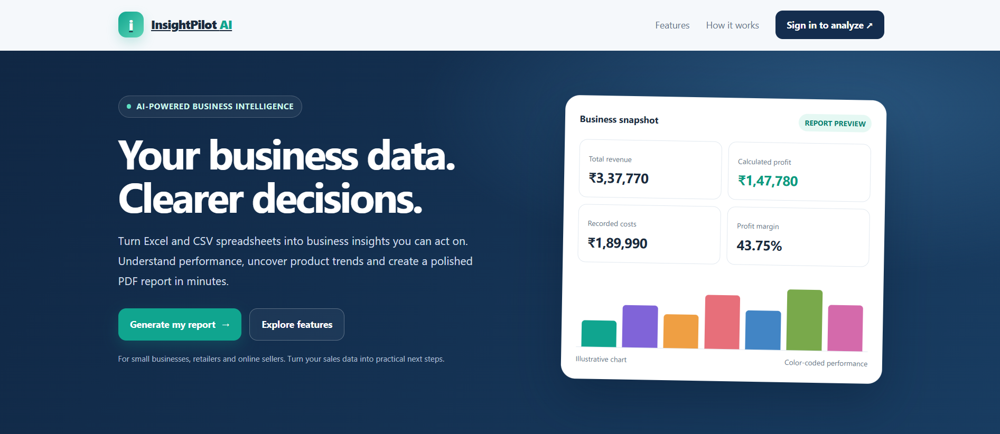

# InsightPilot AI

**Turn business data into clearer decisions.**

InsightPilot AI is an AI-powered business analysis platform that transforms Excel and CSV sales data into financial metrics, visualizations, business insights, and downloadable PDF reports.

## Features

- **Excel and CSV analysis** — Upload business spreadsheets for automated processing.
- **Financial KPIs** — Calculate revenue, recorded costs, profit, and profit margin.
- **Product analysis** — Compare product performance and sales contribution.
- **Monthly performance** — Review revenue, cost, and profit trends.
- **AI-powered recommendations** — Generate concise, data-based suggestions.
- **PDF reporting** — Produce professional reports with charts and findings.
- **User authentication** — Supabase-powered account registration and sign-in.
- **Secure report gateway** — A Supabase Edge Function validates users and forwards requests to the n8n workflow.

## Technology Stack

- HTML, CSS, JavaScript
- Supabase Authentication
- Supabase Edge Functions
- n8n workflow automation
- Netlify hosting
- Git and GitHub

## Project Structure

```text
InsightPilot-AI/
├── index.html
├── InsightPilot_Sample_Sales_Data.xlsx
├── README.md
├── .gitignore
└── supabase/
    └── functions/
        └── generate-report/
            └── index.ts
```

## Concepts and Technologies Used

| Concept | Technology / Application |
|---|---|
| Frontend Development | HTML, CSS, JavaScript |
| Authentication | Supabase Auth |
| Backend API | Supabase Edge Functions, TypeScript |
| API Security | JWT Validation, CORS |
| Workflow Automation | n8n |
| Data Analysis | Revenue, Cost, Profit, and Margin Calculations |
| Data Visualization | Charts and Business KPIs |
| AI Integration | Automated Business Insights |
| Report Generation | HTML-to-PDF Conversion |
| Hosting | Netlify |
| Version Control | Git and GitHub |

## How It Works

1. Create an account or sign in with a verified email.
2. Enter business details and upload an Excel or CSV file.
3. The gateway validates the user and file before forwarding the request.
4. The n8n workflow processes the data and generates a report.
5. Review the resulting business insights and PDF report.

## Live Website

https://insightpilotai.netlify.app

## Sample Dataset

The repository includes a sample sales spreadsheet for testing the reporting workflow. Use fictional or non-sensitive data when testing.


## Screenshots

### Homepage


### Business Analysis Form


### Generated PDF Report


### Product Sales Chart


### Profit by Product


## Security Notes

- Never commit passwords, API secrets, n8n webhook secrets, or Supabase service-role keys.
- Store private credentials in server-side environment variables.
- Configure Supabase authentication, CORS, and data access policies appropriately.
- The Supabase publishable key used by the frontend is intended for browser use; it does not replace proper access controls.

## Future Improvements

- Historical report comparisons
- Scheduled report generation
- More industry-specific analysis
- Additional business performance metrics
- Enhanced report customization

## Author

**Ameya Mahale**

- Email: Ameyamahale860@gmail.com
- LinkedIn: https://linkedin.com/in/ameya-mahale-410881346
- Instagram: https://www.instagram.com/ameya__mahale/

---

*InsightPilot AI — From business data to better decisions.*
